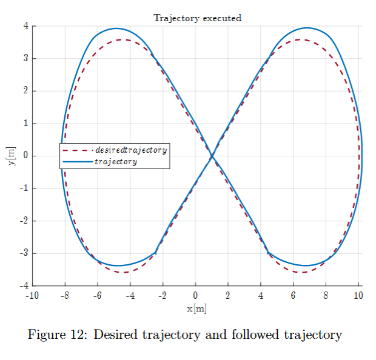
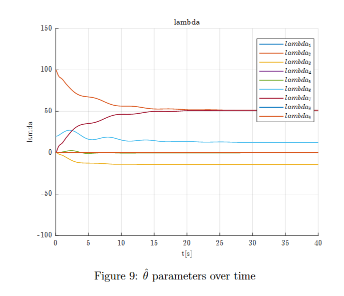

# Underwater Vehicle Control

Nonlinear modelling and pose control of a six-degree-of-freedom underwater vehicle using **MATLAB and Simulink**.

University course project, July 2025. Authors: **Mariateresa Ciuoffi and Gennaro D’Alessio**.

The project investigates how an underwater vehicle can maintain its pose and follow a planned trajectory despite hydrodynamic effects and current disturbances. It combines a nonlinear vehicle model, trajectory planning, a controller with a model-based formulation, and an adaptive controller using a quaternion orientation error.

## Project work

- Implemented a 6-DOF vehicle model including rigid-body inertia, added mass, Coriolis terms, hydrodynamic damping, weight and buoyancy.
- Used inertial and body reference frames to describe pose, velocity and generalized forces.
- Generated position and orientation references for regulation and tracking experiments, combining straight segments and circular arcs with trapezoidal velocity profiles.
- Implemented two control architectures and an online update law for a nine-component compensation parameter vector.
- Evaluated the simulated motion through trajectory, pose-error, force/moment and parameter-estimate plots, with a 3D vehicle animation.

## Vehicle model

The pose and body-frame velocity vectors are

$$\eta=[x,y,z,\phi,\theta,\psi]^T,\qquad\nu=[u,v,w,p,q,r]^T.$$

The project uses the nonlinear dynamics

$$M\dot\nu+C(\nu)\nu+D(\nu)\nu+g(\eta)=\tau-\tau_{\mathrm{current}},$$

where $M$ contains rigid-body and added-mass contributions, $C$ represents Coriolis terms, $D$ represents damping, $g$ represents weight and buoyancy effects, and $\tau$ contains the commanded forces and moments.

The simulated controller applies six generalized force/moment inputs directly. Individual thruster dynamics, allocation and actuator limits are outside the implemented model.

## Control approaches

| Model | State and feedback | Control formulation |
| --- | --- | --- |
| `ControlA.slx` | Position and Euler angles in the inertial frame | A model-based structure with PID feedback and restoring-force compensation. The full inertia/Coriolis/damping feedforward expression is retained in the code but is commented out in the saved version. |
| `ControlE.slx` | Body-frame velocities, body-frame position error and quaternion orientation error | Adaptive feedback with a nine-component estimate used to compensate generalized forces and moments. |

### Controller with model-based formulation

The full formulation combines dynamic compensation with feedback:

$$\tau=M^*\ddot p_r+C^*\dot p_r+D^*\dot p_r+g^*+\Lambda s.$$

In the current saved model, the active command is $\tau=g^*+170s$, with $s$ combining proportional, derivative and integral error terms. This distinction matters when relating the source code to the original presentation.

### Adaptive controller

The adaptive command is

$$\tau=K_Ds_v+K\tilde y+\Phi\hat\lambda,$$

with the implemented update law

$$\dot{\hat\lambda}=16\Phi^Ts_v.$$

The hybrid pose error $\tilde y$ combines a position error expressed in the body frame with the vector part of the relative quaternion error. The estimate $\hat\lambda\in\mathbb{R}^9$ contributes to force/moment compensation through the regressor $\Phi$; it does not update the mass, Coriolis or damping matrices.

Although the controller uses a quaternion error, the simulated pose is still integrated using Euler angles.

## Experiments and reported results

The original presentation includes:

- **Regulation:** maintaining a nearly constant position and orientation under disturbances.
- **Tracking:** following a planar trajectory with two lobes and a varying yaw reference.
- **Adaptation:** observing the evolution of the compensation estimates and comparing with a non-adaptive variant.

The following figures were extracted from the original project presentation. They document the reported experiments; they have not been regenerated from the current saved models, whose settings and active control expressions require revalidation. The two saved models also use different yaw references and disturbance representations, so these figures should not be treated as a controlled quantitative comparison.

### Adaptive trajectory tracking



### Parameter estimates during regulation



Additional figures: [model-based tracking](docs/figures/model-based-tracking.png) and [adaptive tracking errors](docs/figures/adaptive-tracking-errors.png).

The complete explanation and reported results are available in the [project presentation](docs/presentation.pdf). An [editable PowerPoint version](docs/presentation.pptx) is also included.

## Requirements

- MATLAB and Simulink. The models were saved in **R2024b**.
- Run the models with `matlab/` as the MATLAB current folder, so their initialization and animation callbacks can find the scripts.
- A standard `skew.m` helper is included to construct the 3D cross-product matrix used by the models.

The project uses 1 ms reference sampling and Zero-Order Hold blocks. The continuous solver is configured as variable-step automatic.

## Running the project

1. Download or clone the repository and open MATLAB.
2. Set the current folder to the repository’s `matlab/` directory.
3. Open one model:

   ```matlab
   open_system('ControlA');
   % or
   open_system('ControlE');
   ```

4. Click **Run** in Simulink. Initialization callbacks generate the reference automatically, and stop callbacks run the corresponding animation. The simulation data are exported to the workspace as `out`.
5. After the simulation, generate the plots:

   ```matlab
   plotA;   % after ControlA
   % or
   plotE;   % after ControlE
   ```

### Saved initialization settings

| Model | Initialization script | Simulation stop time |
| --- | --- | --- |
| `ControlA` | `circeuler.m` | 120 s |
| `ControlE` | `trajectory_q_8.m` | 115 s |

Both tracking generators create seven 16 s segments, giving 112 s of reference data. The model settings determine how the reference behaves after its final sample.

For regulation experiments, select the corresponding nearly constant reference generator in the model’s **InitFcn** callback: `FermoEulero.mlx` for the Euler-angle reference or `Fermo.m` for the quaternion reference. Running one of these scripts before starting a model is insufficient if its saved InitFcn then overwrites the reference.

## Repository contents

| Path | Contents |
| --- | --- |
| `matlab/ControlA.slx`, `matlab/ControlE.slx` | Simulink vehicle and controller models |
| `matlab/circeuler.m`, `matlab/trajectory_q_8.m` | Tracking-reference generators |
| `matlab/FermoEulero.mlx`, `matlab/Fermo.m` | Nearly constant regulation references |
| `matlab/linearpath.m`, `matlab/circularpath.m` | Path primitives and time profiles |
| `matlab/plotA.m`, `matlab/plotE.m` | Plotting and figure export |
| `matlab/VidControlA.m`, `matlab/vidControlE.m`, `matlab/vid.m` | Vehicle animations |
| `matlab/skew.m` | Standard cross-product helper added for this repository package |
| `docs/` | Presentation, result figures and implementation notes |

Simulink caches and generated plotting folders are excluded from version control.

## Current status and next steps

This repository documents the original course-project source and its reported results. The original models and scripts are preserved; `skew.m` is an added helper. No new MATLAB/Simulink execution has been performed when preparing this repository package.

A source review identified items to address before claiming reproducible controller performance:

- Make the circular-path velocity and acceleration outputs consistent with the generated position.
- Align the angular kinematic matrices, their derivatives and the coordinate transformations in `ControlA`.
- Check the restoring-force moment arms and the velocity/reference-frame conventions in `ControlE`.
- Reconcile the saved control laws with the presentation and rerun both controllers under identical references and disturbances.

See [implementation notes](docs/IMPLEMENTATION_NOTES.md) for the concrete source-level findings. The archived plots do not establish unique physical-parameter identification or a stability guarantee for the current saved implementation.

